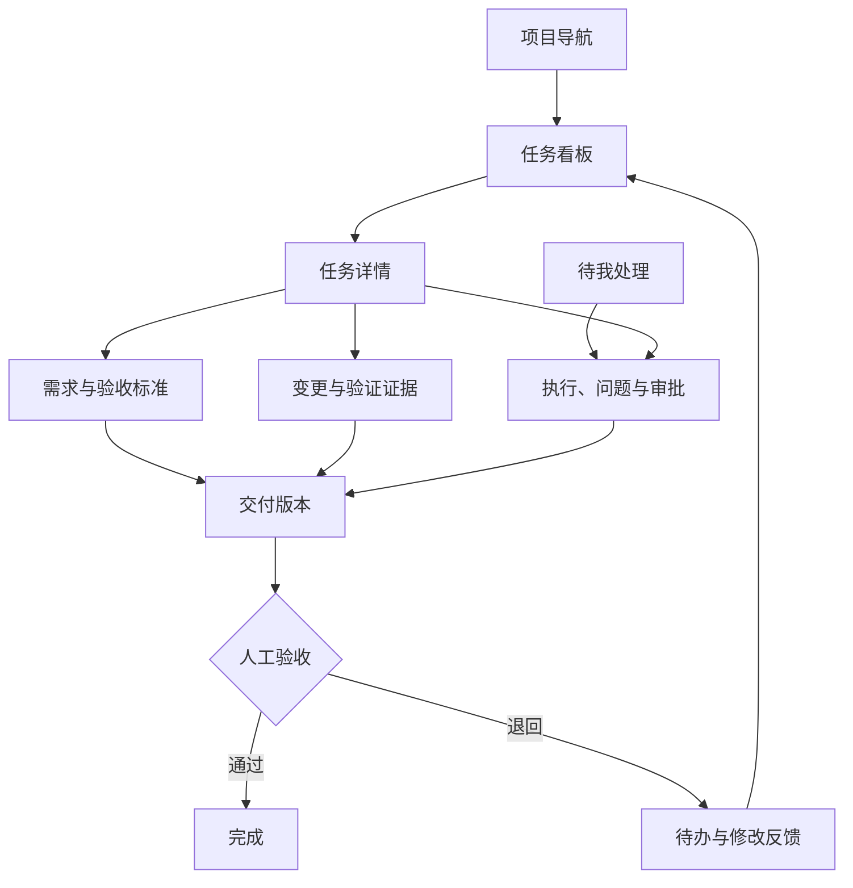
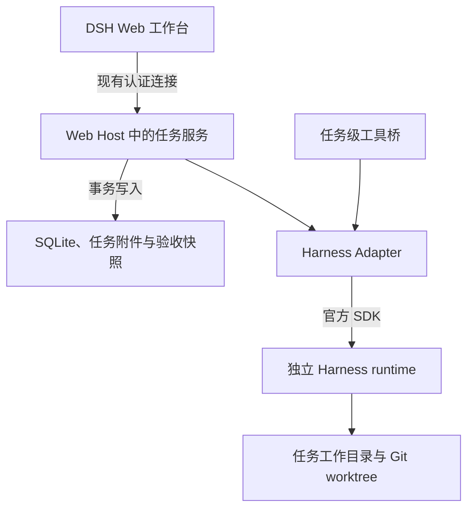

# DeepSeek Harness Taskboard 

English | [中文](DeepSeek_Harness_Taskboard_PRD_v0.1.zh.md)

**Product requirements document**

**Version** v0.1

**Date** November 11, 2026

**Status** Awaiting review

**Related documents** [Original Word document](DeepSeek_Harness_Taskboard_PRD_v0.1.docx), [main PRD](DSH_PRD_vNext_4_2026-10-27.md#93-任务工作台-mvp), [implementation task mapping](../workflows/DSH_IMPLEMENTATION_PLAN.md#16-taskboard-增量实施计划) and [implementation progress](../workflows/DSH_IMPLEMENTATION_PLAN.md#1210-taskboard-增量-checklist). TBOARD-00 confirmed reuse of the existing DSH Web app, host and authentication. The main plan holds implementation evidence.

> This document preserves the text and tables from Word v0.1. The two diagrams use editable Mermaid and render directly in Markdown readers with Mermaid support.

## Overview 

Build a local-first workspace for AI coding tasks. Each task holds requirements and acceptance criteria, DeepSeek Harness hosts real sessions, and execution records track every attempt. From a task card, users start work, follow progress, answer questions, inspect delivery and confirm completion.

### Product decisions 

- Embed the MVP in the existing DSH Web app, reusing its host and authentication. The task service owns the business database. Each Run starts a dedicated runtime through the official TypeScript SDK.

- Serve one operator in the first version, focusing on individual developers' everyday coding tasks. Task records support handoff within a small team. Online multi-user collaboration comes later.

- Run one task at a time by default. Give each active execution its own runtime. Enable limited parallelism only after verifying isolation and stop behavior.

- An agent can report progress, blockers and deliveries. Only a user can mark the task complete. Record permission approvals separately from delivery acceptance.

### Purpose 

Give product, design, engineering and test teams a common scope, state model, interface responsibilities and release criteria. P0 denotes MVP requirements, P1 the next stage and P2 future investigation. All performance numbers are proposed acceptance targets pending a measured baseline.

| Scope | Definition |
| --- | --- |
| Product name | Harness Taskboard is the working title. |
| Delivery | Desktop browser accessing a local service, local task database and Harness runtime |
| Workflow | Create task → execute → submit delivery → human acceptance → complete or return |
| Version constraint | Harness is in developer preview. Pin the exact integration-tested version for release. [S01](https://github.com/deepseek-ai/deepseek-harness) |
| Launch platform | Freeze one OS in G0 based on the actual development environment. Mark other platforms supported after compatibility validation. |

Read sections 1–4 for scope, sections 5–10 for behavior and integration, and sections 13–16 for release criteria.

## Contents 

- [1 Reference products and design decisions](#1-参考产品与设计结论)
- [2 User scenarios and release scope](#2-用户场景与版本范围)
- [3 Workflow and interface](#3-主流程与交互结构)
- [4 Task management requirements](#4-任务管理需求)
- [5 Execution and recovery requirements](#5-执行与恢复需求)
- [6 Delivery and human acceptance](#6-交付与人工验收需求)
- [7 Task states and transitions](#7-任务状态与转移规则)
- [8 Run states and event consistency](#8-执行状态与事件一致性)
- [9 Harness integration architecture](#9-harness-接入架构)
- [10 Integration capabilities and validation](#10-接入能力与验证门槛)
- [11 Data model and service responsibilities](#11-数据模型与服务边界)
- [12 Reliability and nonfunctional requirements](#12-可靠性与非功能需求)
- [13 Functional acceptance cases](#13-功能验收用例)
- [14 Recovery and control acceptance cases](#14-恢复与控制验收用例)
- [15 Iteration plan and risks](#15-迭代计划与风险)
- [16 Open decisions and review checklist](#16-待确认决策与评审清单)
- [17 References](#17-参考来源)

## 1 Reference products and design decisions 

The references cover task management, execution workspaces, code review and multi-agent collaboration. Taskboard centers on tasks and human acceptance and adopts individual features as the MVP requires.

| Reference | Verified feature | Use in Taskboard |
| --- | --- | --- |
| dashi taskboard | Binds tasks to sessions, lets agents report progress and requires user confirmation to complete. [S08](https://github.com/chuspeeism/dashi-taskboard/blob/main/README.zh-CN.md) | Adopt task fields, states and pending acceptance. Design a separate Harness Session adapter. |
| KanDev | A task workspace combines plans, conversations, code changes and review. [S09](https://kandev.ai/) | Open execution details from the board. Offer read-only change review in the first version. |
| Vibe Kanban | Separates issues from workspaces and opens details and execution information beside the board. [S10](https://www.vibekanban.com/docs/getting-started) | Reference for task cards, the details panel and linking multiple executions. |
| Multica | Stores discussions and execution history per task and assigns people or agents by stage. [S11](https://multica.ai/docs/issues) | Adopt the activity timeline and separate tasks from runs. Defer automatic handoff between roles to P1. |
| Emdash Classic | Organizes sessions, terminals, branches and review state by task. [S12](https://emdash.com/classic) | Use its organization of execution details. A full IDE is outside the first version. |

### Two implementation decisions 

UI embedding and execution integration require separate validation. The verified dashi integration adds a sidebar entry and opens an independent Taskboard in an iframe. This demonstrates embedding. Reuse of Codex session binding with Harness remains unverified. [S13](https://github.com/chuspeeism/dashi-taskboard/tree/5c96d1ab698362994283ba0af86021db0a98dd89/integrations/deepseek-harness)

UI references do not require adopting the full underlying architecture. Vibe Kanban announced a move to community maintenance and removal of its hosted board. Emdash Classic shifted its new feature development elsewhere. This PRD references their interfaces and workflows without taking a runtime dependency. [S10a](https://www.vibekanban.com/blog/shutdown)[S12](https://emdash.com/classic)

### Community implementation for further evaluation 

cloader/dsh-taskboard publishes a community Harness task plugin. Its task-scoped tools, separate sessions and acceptance rules merit evaluation. Check compatibility against the exact version. Its tool names and methods do not define the official SDK. [S14](https://github.com/cloader/dsh-taskboard)

## 2 User scenarios and release scope 

### Users and needs 

Developers working on multiple coding tasks need to find requirements, progress and results by task. In a chat interface, requirement versions, sessions, branches and review comments can become scattered. After failure or interruption, it can be difficult to tell which results remain valid.

| Scenario | User objective | Success criterion |
| --- | --- | --- |
| Start work | Give Harness the requirements and retain acceptance criteria | Verify project, input version and run configuration before launch. |
| Follow execution | Distinguish active work, a pending question and a problem | Each card shows actual status, latest event and next action. |
| Recover | Retry a failed task or continue its session | Preserve the original record and create a new execution without overwriting results. |
| Accept delivery | Inspect changes and verification, then accept or return | The user confirms a specific delivery version. |
| Hand off | Give a colleague task context, history and conclusions | Exports preserve relationships. Online collaboration is separate work. |

### P0 scope 

Project and local directory configuration, task board and list, requirements and acceptance criteria, manual start/stop/retry and session recovery, real events, questions and approvals, task working-directory locks, read-only change review, delivery and human acceptance, persistent events, restart reconciliation, export, backup and restore.

### P1 and P2 scope 

P1 covers limited parallelism, parent/child tasks and blocking dependencies, controlled automatic claiming, team accounts, collaboration and PR/CI integration. P2 covers cross-machine execution, complex agent orchestration, scheduled automation, cost budgets, a full editor and browser previews.

### Priority rules 

Defects affecting execution identity, state accuracy, permission semantics or human acceptance block release. Visual polish, charts and advanced filtering cannot compensate for those defects. Freeze the launch OS, backup directory and model configuration at G0. Show only verified combinations as supported.

## 3 Workflow and interface 

The interface has project navigation, a task board and task details. Cards prioritize title, priority, execution status and pending items. The execution page contains logs, session identifiers and environment details.

*Figure 1. Task board and acceptance detail layout. The example task illustrates the interaction.*

| Page | Contents and actions |
| --- | --- |
| Task overview | Switch projects, status columns and list view, search titles, and filter by priority or pending items. |
| Task details | Inspect requirements, criteria, comments and previous runs, start or retry, and compare requirement versions. |
| Execution details | Follow live activity, questions, approvals, session information, working directory and read-only file changes, or stop execution. |
| Delivery acceptance | Inspect implementation notes, change summary, checks, risks and unfinished items, then accept or return. |
| Runtime and settings | Inspect integration health, compatible versions, model configuration, backups and exports. |

Create a project, define requirements and criteria, check configuration, start execution, resolve questions or approvals, prepare a delivery and have a user accept or return it. Closing the details page leaves execution running.

## 4 Task management requirements 

### FR01 Project and integration checks 

Bind each project to a normalized local directory. Optionally record its Git repository and default base branch. On first use, check the Harness executable version, SDK connection, credential availability, directory permissions and runtime configuration. Show available, unavailable and unverified capabilities in settings.

**Acceptance** Identify each missing prerequisite. When launch conditions fail, allow task editing and block execution.

### FR02 Task fields and board 

Store title, description, acceptance criteria, priority, labels, project, state and version. Require a title and project at creation. Require a clear objective and at least one acceptance criterion before execution. Support dragging, sorting, search and filtering by state.

**Acceptance** Allowed drags follow the shared transition rules. Dragging to Done must enter the acceptance workflow.

### FR03 Requirement versions and context 

Each edit to the description or criteria creates a task version. At launch, snapshot requirements, criteria, selected file references, prior feedback and run configuration. The active Run keeps its input snapshot. Flag deliveries for earlier requirements as stale.

**Acceptance** During a Run, show that requirements changed and the current execution still uses version N. The next Run explicitly adopts the new version.

### FR04 Comments and history 

Present user discussions, agent progress summaries, state changes, execution records, deliveries and acceptance decisions together. Identify the author, time and source. Expand long logs on demand.

**Acceptance** Retry and archive preserve past logs. Append corrections to historical events without silently rewriting them.

### Input and UI limits 

Include attachments in context as selected by the user. Do not read the entire filesystem automatically. Treat original task and attachment contents as input data without authority to escalate permissions or accept delivery. Hide unavailable model capabilities by default and avoid invented progress percentages.

## 5 Execution and recovery requirements 

### FR05 Manual start and queuing 

At start, the service atomically checks task version, active execution lock and working-directory lock and creates an idempotency key and Run. Persist launch intent before creating the runtime. Default concurrency is one. Each task and Session can have only one active execution owner.

**Acceptance** Double-clicks, replayed requests and restart recovery must never create an additional effective execution. Users can cancel queued tasks directly.

### FR06 Progress and pending interactions 

Drive the UI from actual Harness events and state. Questions and permission requests appear separately in the user's pending items. Cards display counts, latest event and connection status. Streamed logs can collapse while the original auditable record is retained.

**Acceptance** Deduplicate displayed events. A broken stream signals a connection problem. Silence alone cannot establish success, failure or termination.

### FR07 Stop and cancel 

Move an active execution to stopping. The adapter requests shutdown of the Run's dedicated runtime and confirms exit of the target process tree. If the deadline expires, show unconfirmed status and let the user force termination. Record queue cancellation separately from runtime interruption.

**Acceptance** The SDK provides no per-session cancellation interface at this baseline. Stop only the target Run and retain its code changes. [S03](https://github.com/deepseek-ai/deepseek-harness/blob/master/packages/sdk/server/README.md)

### FR08 Retry and session recovery 

Retry, changes after return and continuation each create a new Run linked to the previous one. In the original directory, first restore the real Session, then explicitly send the confirmed input snapshot. Viewing history sends no input. If recovery fails, let the user select a new session and what it inherits. A directory change creates a new Run and Session, preserving previous records and source materials. Record old and new directories, branches and previous references. Inherit only material the user explicitly selects.

**Acceptance** Save the input acceptance receipt. Reconcile before resending if the send outcome is unknown. Recovery does not recreate external processes automatically. Verify directory and branch before continuing. [S02](https://github.com/deepseek-ai/deepseek-harness/blob/master/packages/sdk/client/README.md)

### FR09 Working directories 

For Git projects, pin the base commit before creating a worktree and verify the Session's actual working directory. Block launch if required isolation fails. Users can explicitly choose serial execution in the original directory, reconfirm the branch and uncommitted changes and create a new Run. Non-Git directories support serial execution only.

**Acceptance** Check missing bases, occupied directories and path aliases. Send no input after isolation failure. Ending or accepting work preserves the directory.

## 6 Delivery and human acceptance 

### FR10 Structured delivery 

The agent submits implementation notes, change scope, results by criterion, verification evidence, known issues and unfinished work. The service records Delivery version, Run, requirement version and code snapshot. Verification states are limited to passed, failed, not run and not applicable.

**Acceptance** A model saying “done” or a zero exit status cannot set Done. Prompt for missing required evidence.

### FR11 Reviewing changes 

The first version provides a file list and read-only text diff, showing the baseline, current changes and binary-file notices. Load large diffs in parts or allow viewing through external tools. For non-Git directories, state what file history can be verified.

**Acceptance** Before acceptance, check for changes to HEAD, uncommitted changes and untracked files included in delivery. Comparing commit IDs alone is insufficient.

### FR12 Accepting and returning 

The user checks each acceptance criterion on a specific Delivery. Record a Review on acceptance. On return, retain feedback, move the task to to-do and carry feedback into the next Run. A delivery for stale requirements must cover the new criteria or the user must explicitly revert the requirement change with an audit record.

**Acceptance** Verify the current requirement version and code snapshot. Block acceptance during active execution or while approval is outstanding. A human must give a reason to waive a failed check.

### FR13 Permissions and user questions 

Tool authorization applies only to its current request with Harness's original scope and outcome semantics. Questions supply task information only. Display and route these separately. A response must match the actual request and owning Run.

**Acceptance** A late reply cannot authorize an approval after disconnection, withdrawal or expiration. Never convert denial or cancellation to permission automatically. [S04](https://github.com/deepseek-ai/deepseek-harness/blob/master/packages/sdk/protocol/README.md)[S05](https://deepseek-harness.github.io/deepseek-harness/en/reference/subsystems/approval)

### FR14 Archiving and changes after completion 

A completed task retains Delivery, Review, Session references and execution records. For new requirements, explicitly reopen the task or create a linked task. Preserve the prior acceptance.

**Acceptance** Agents cannot mark tasks complete, grant human waivers, accept deliveries or rewrite past acceptance.

## 7 Task states and transitions 

Task represents business progress toward an objective. Run represents one execution. Pending questions, pending approvals and connection issues use separate indicators so that a temporary wait does not become a business blocker.

| State | Meaning | Entry and exit |
| --- | --- | --- |
| backlog Unscheduled | Work has not been scheduled | The user moves it to todo. No direct dispatch. |
| todo Ready | Work is eligible for launch | Start after input and environment checks. Move to in_progress after successful launch. |
| in_progress In progress | Work is executing or its result needs processing | Move to in_review after execution ends with a valid Delivery. Explicit failure can move it to blocked. |
| in_review Awaiting acceptance | A specified delivery version can be reviewed | Human acceptance sets done. Return sets todo. Completion requires human confirmation. |
| blocked Blocked | Missing prerequisites or a failure requiring action | Record a reason. Once resolved, the user moves the task back to todo. |
| done Completed | A user accepted a specific Delivery | Keep the Review. Further work requires explicit reopening or a new task. |
| canceled Canceled | The user abandons the objective | Confirm termination of any active execution first. Explicitly return to todo to resume. |

### Automatic transitions 

Successful launch can move a ready task into progress. Enter review only with a valid Delivery, an ended owning Run, no pending questions or approvals and an identifiable delivery snapshot. Failed or unexecuted checks can be submitted for review if clearly disclosed with their actual status.

### Server-enforced rules 

Agent writes can report progress, blockers, comments and deliveries only. Only a human acceptance command sets done. State commands include the expected version. Validate version, execution lock and transition conditions in one transaction. On conflict show the new state and let the user act again.

Task cancellation, stopping a Run and returning a Delivery are separate actions. Stopping a Run blocks the task by default with the reason “execution interrupted.” Canceling a task means abandoning the objective.

## 8 Run states and event consistency 

| Run state | Meaning | Evidence |
| --- | --- | --- |
| queued | Waiting for an execution slot | Execution request persisted, runtime unassigned. |
| preparing | Preparing directory and runtime | Runtime starting or Session being created or restored. |
| running | Within an execution activity interval | Actual SDK events and status. Record start time. |
| finished | The activity interval ended | SDK finished and the dedicated runtime is confirmed to have exited. Human task acceptance is separate. |
| failed | Execution failed | Launch error, protocol error or confirmed execution failure. |
| canceled | Canceled before launch | No work executed and the queue cancellation transaction succeeded. |
| interrupted | Execution interrupted | Stop, runtime exit, forced termination or confirmed loss of contact. |

Control state is normal, finalizing or stop_requested. Track connection separately as connected, suspect or disconnected. Count pending answers and approvals independently. A pending approval does not establish that every subprocess is paused.

### Deriving product state from Harness events 

The messageId from session/prompt means only that input was accepted. An idle session.status and return from SDK run describe the activity interval. The adapter must consider Run ownership, valid delivery and pending requests together. Neither final text nor idle can accept a delivery. [S02](https://github.com/deepseek-ai/deepseek-harness/blob/master/packages/sdk/client/README.md)[S03](https://github.com/deepseek-ai/deepseek-harness/blob/master/packages/sdk/server/README.md)[S04](https://github.com/deepseek-ai/deepseek-harness/blob/master/packages/sdk/protocol/README.md)

### Duplicate events and restart reconciliation 

Prefer official durable event identities. Where notifications lack stable replayable IDs, retain raw payloads and an adapter cursor. Reconcile Session and runtime snapshots after reconnect. Older events cannot revert a newer terminal state. Import historical records separately from new notifications.

On restart, show Run, runtime identity, last event and directory occupancy. Allow rechecking and terminating confirmed owned execution. Explain when a channel cannot be reclaimed. Only after confirming the original instance exited may the service mark it interrupted, release locks and allow a new Run to restore that session. PID or an expired lease alone cannot establish ownership or permit release.

### Finalizing execution 

After SDK activity ends, persist its result receipt, then close the Run's dedicated runtime. Confirm exit before sealing the code snapshot and delivery, committing terminal state and releasing leases. Preserve dshHome and code directories. With no valid delivery, move the task to blocked and show “Execution ended, delivery required.” Allow completion of the delivery record from actual evidence or creation of a new Run.

## 9 Harness integration architecture 

Use one execution control path. The task service calls the official SDK through the Harness Adapter. A dedicated runtime runs the Session. The task service owns business state and acceptance authority. Harness owns execution, model and tool semantics. [S01](https://github.com/deepseek-ai/deepseek-harness)[S02](https://github.com/deepseek-ai/deepseek-harness/blob/master/packages/sdk/client/README.md)

*Figure 2. Task service, business database and dedicated runtime in the first version.*

### Data and execution ownership 

The task database is authoritative for business state. Each Run records runtime identity, Session reference, task snapshot and directory lease. The runtime exclusively owns current execution. A task or explicit session scope owns persistent dshHome. The next Run may restore the same session only after the old instance exits and releases its lease.

### Plugins and MCP 

Native Harness Slots and the right sidebar can host the page without DOM injection. [S06](https://deepseek-harness.github.io/deepseek-harness/en/reference/subsystems/slots) MCP can expose task-service tools to agents. The adapter still owns Session launch, recovery and stop. The native Web runtime and SDK runtime must never control the same Session simultaneously. [S07](https://github.com/deepseek-ai/deepseek-harness/blob/master/packages/mcp/README.md)

## 10 Integration capabilities and validation 

| Capability | Verified official behavior | Product implementation and validation |
| --- | --- | --- |
| Start execution | TS SDK and stdio JSON RPC session control. [S02](https://github.com/deepseek-ai/deepseek-harness/blob/master/packages/sdk/client/README.md)[S04](https://github.com/deepseek-ai/deepseek-harness/blob/master/packages/sdk/protocol/README.md) | Initialize the adapter and create a real Session. Record exact versions and configuration summary. |
| Synchronize events | Session events and status notifications. [S04](https://github.com/deepseek-ai/deepseek-harness/blob/master/packages/sdk/protocol/README.md) | Normalize events and verify duplicates, disconnection and historical reads. Unconditional automatic replay is outside the guarantee. |
| Restore session | Restores persistent Sessions without automatically sending new input. [S02](https://github.com/deepseek-ai/deepseek-harness/blob/master/packages/sdk/client/README.md)[S03](https://github.com/deepseek-ai/deepseek-harness/blob/master/packages/sdk/server/README.md) | Check sessionId, dshHome, directory and ownership. Preserve original records on failure. |
| Stop execution | No per-session close or prompt-cancel wire method at this baseline. [S03](https://github.com/deepseek-ai/deepseek-harness/blob/master/packages/sdk/server/README.md) | Assign a dedicated runtime per Run and confirm exit after shutdown. Record forced termination as interruption. |
| Human approval | Supports enabling approvalRequests and receiving approval/request. [S03](https://github.com/deepseek-ai/deepseek-harness/blob/master/packages/sdk/server/README.md)[S04](https://github.com/deepseek-ai/deepseek-harness/blob/master/packages/sdk/protocol/README.md) | Display scope and action. Support allow once, deny and cancel. Test late responses after disconnection. |
| User questions | Protocol supports user-question/ask and cancellation notifications. [S04](https://github.com/deepseek-ai/deepseek-harness/blob/master/packages/sdk/protocol/README.md) | Provide a separate question entry. Match request identity and reject answers after cancellation. |
| UI extensions | React Slots and right sidebar registration. [S06](https://deepseek-harness.github.io/deepseek-harness/en/reference/subsystems/slots) | The initial native page connects to the same task service and execution control path. |
| Tool connections | MCP client connects external tools and resources. [S07](https://github.com/deepseek-ai/deepseek-harness/blob/master/packages/mcp/README.md) | Task-scoped tool bridge in P0. Open MCP integration in P1. |
| Directory isolation | Sessions can set a working directory. Sandbox modes govern file effects. [S04](https://github.com/deepseek-ai/deepseek-harness/blob/master/packages/sdk/protocol/README.md)[S15](https://deepseek-harness.github.io/deepseek-harness/en/reference/subsystems/sandbox) | The product manages worktrees and displays effective permissions. Separate directories alone do not provide full security isolation. |

### Required G0 integration validation 

Create a real session, associate two successive executions with one task, restore the original session after runtime shutdown, allow/deny/cancel tool requests and answer user questions. Verify stopping one runtime leaves a second instance unaffected, directory changes remain traceable and service interruption does not duplicate execution.

After verification, freeze Harness, SDK, runtime and OS versions. If a critical check fails, adjust scope or integration first. Simulated state cannot satisfy acceptance. Rerun the same compatibility cases for every Harness upgrade. [S01](https://github.com/deepseek-ai/deepseek-harness)

## 11 Data model and service responsibilities 

| Object | Responsibility and principal fields |
| --- | --- |
| Project | projectId, normalized root, repository, base branch and runtime configuration reference |
| Task | taskId, projectId, requirements, acceptance criteria, priority, state, version and current delivery reference |
| Run | runId, taskId, previous Run, input snapshot, sessionRef, runtimeId, directory lease, state and termination reason |
| SessionRef | provider, actual sessionId, dshHome reference, workspace, compatible versions and recovery status |
| Delivery | deliveryId, taskId, runId, task version, delivery version, change snapshot, verification evidence and unfinished work |
| Review | reviewId, deliveryId, snapshot fingerprint, acceptance or return, reviewer, reason and time |
| Event | eventId, runId, original source identity, product cursor, type, redacted payload, occurrence and receipt times |
| Interaction | Request type, original request ID, runId, pending or terminal state, response, expiry and revocation record |
| Lease | Execution and directory ownership, runtime identity, lease generation, activity state and reconciliation outcome |

### Relationships and constraints 

A Task can have multiple Runs and Deliveries. Each Run references one main Session. Record subagent events as subordinate executions. Runs can reuse the same main Session sequentially with no concurrent ownership. Each Review identifies one Delivery version and its code snapshot.

### Product service commands 

UI commands cover creating and editing tasks, starting, stopping, retrying, restoring, answering questions, responding to approvals, submitting for acceptance, accepting and returning. Limit proposed agent tools to reading the current task, reporting progress or blockers, commenting and submitting delivery. These names describe logical product capabilities, independently of official Harness APIs.

Validate actor, task scope, runId, expected version and idempotency key on every write. Model-supplied IDs are input only. The server binds runId, Session ownership and write scope. Commit results transactionally with the state change and its source.

## 12 Reliability and nonfunctional requirements 

| ID | Requirement | Acceptance target or rule |
| --- | --- | --- |
| NFR01 | Explainable state | Show a cause, latest event and next action for every exception. Keep unknown distinct from success. |
| NFR02 | Interaction performance | On a local connection with 2,000 tasks on an 8-core, 16 GB SSD reference machine, the first board screen loads in at most 2 seconds at P95. Reflect state in the UI within 1 second of receipt by the service. |
| NFR03 | Persistence | Persist critical commands before acknowledgment. Commit state and activity atomically. A crash must preserve confirmed acceptance. |
| NFR04 | Consistent recovery | Restart never duplicates execution. Ignore duplicate events and prevent older events from overwriting terminal state. |
| NFR05 | Permissions | Default to loopback. Verify request origin and session token. Block launch if native permission configuration fails. |
| NFR06 | Credentials and logs | Manage credentials through controlled configuration. Exclude them from tasks, ordinary logs and default exports. Redact tool output and expand it on demand. |
| NFR07 | Data portability | Version exports, backups and restores. Preserve task, Run, Delivery and Review relationships. Import starts no runs. |
| NFR08 | Resources and files | Preserve working directories after stop or completion. For cleanup, show ownership and uncommitted changes and require explicit user selection. |
| NFR09 | Compatibility | Record the tested version matrix in the release. Block incompatible integrations while preserving data. Back up before migration. |

### Minimum failure handling 

For expired credentials or service outages, preserve the task and show how to restore service. Keep unanswered approvals pending without automatic permission. At an output limit or runtime error, preserve produced files and logs, show the end reason and allow a new Run. On insufficient disk space or persistence failure, reject new execution and acceptance commands so the UI cannot indicate unpersisted success.

### Export, backup and retention 

A handoff export includes tasks, Run summaries, deliveries, reviews and selected attachments by default. Exclude credentials, raw tool output and full session directories. A restorable backup requires a version, manifest and integrity checks. Indicate whether Session data is complete. Session recovery depends on those data and compatible versions.

Restore to a new database or instance with no active execution. Never silently overwrite or merge corrupt, incompatible or colliding records. Restore does not recreate processes, replay approvals or start execution. Retain tasks and acceptance evidence by default. Select cleanup of logs, attachments, Sessions and working directories separately. Protect evidence still referenced by a delivery or review.

## 13 Functional acceptance cases 

Releases require the following scenarios in isolated projects. Retain evidence of events and process ownership. UI messages alone cannot establish success.

| ID | Scenario | Pass criteria |
| --- | --- | --- |
| AC01 | Restart after saving | Requirements, criteria, state, order and task ID persist. All acknowledged writes are recovered. |
| AC02 | Double-click start and replay a request | Exactly one effective Run and execution instance. Repeat requests return the same result. |
| AC03 | Edit requirements during execution | Task version increases, old Run snapshot stays fixed and the user sees the version change. |
| AC04 | Retry after failure | Create a new Run linked to the previous one. Old errors, logs and session references remain inspectable. |
| AC05 | Agent claims completion | Without human Review the task cannot enter done. Execution end and acceptance are distinct. |
| AC06 | Verification failed or never ran | Show actual verification status and evidence. Only a human can waive a check with a reason. |
| AC07 | Return for changes | Feedback references the original Delivery. The next Run includes it and preserves the old delivery. |
| AC08 | Results change during acceptance | Updated requirements or criteria expire the old delivery. Active execution or code changes block acceptance. Refreshing the old diff cannot unblock it. |
| AC09 | User question | Show accurate content and task. Deliver the answer only to the original request. Reject sending after cancellation. |
| AC10 | Native permission approval | Preserve allow once, deny and cancel semantics. Disconnection or expiry never defaults to allow. |

### Acceptance evidence 

For every run record software versions, configuration summary, task and Run IDs, working directory, key events, exit status and final database records. Permission cases check both the Harness outcome and whether the external action occurred. Acceptance cases check both the Delivery snapshot and Review record.

## 14 Recovery and control acceptance cases 

| ID | Scenario | Pass criteria |
| --- | --- | --- |
| AC11 | Missing or incompatible session | Report recovery failure without silently creating a replacement. Let the user choose a new Run and context. |
| AC12 | Stop target execution | Show stopping first. Mark interrupted only after the target process tree exits. Leave other instances running. |
| AC13 | Unexpected task-service restart | Reconcile leases and process identity without resending the original launch. Make unknown states visible. |
| AC14 | Out-of-order events and brief stream loss | Deduplicate events and preserve terminal states. After reconnection, reconcile against actual Session and results. |
| AC15 | Directory conflict or isolation failure | Locks cover aliases and nested directories. No silent fallback on missing base, occupied directory or worktree creation failure. |
| AC16 | Import backup | Corrupt, incompatible or colliding records never overwrite existing data. Identify missing Sessions. Restore neither processes nor approvals. |
| AC17 | Database write fails after runtime starts | Enter auditable launch reconciliation. Leave no unknown execution eligible for duplicate launch. |
| AC18 | Forced termination times out | Show unconfirmed status and retain locks and directory. Never claim the execution stopped. |
| AC19 | Permission configuration fails | Block launch and show why. Never continue silently with broader permissions. |
| AC20 | Incompatible upgrade | Reject unsupported sessions, preserve data and snapshots, and provide a working recovery path. |

### Release quality criteria 

Pass every P0 case. Require zero unintended duplicate executions, human Review for 100% of done tasks, zero lost confirmed acceptances, zero expanded approval scopes and zero unintended stops of other tasks. Before release, complete at least one real coding task through launch, failure, retry, delivery, return and renewed acceptance.

These are controlled acceptance thresholds. Production reliability requires separate evidence. During trials, establish baselines for the first task, task lookup and acceptance before setting optimization targets.

## 15 Iteration plan and risks 

| Stage | Deliverables | Exit criteria |
| --- | --- | --- |
| G0 Integration validation | Pin Harness, SDK, runtime and OS combination. Verify Sessions, approvals, questions, stop and recovery. | Pass every section 10 integration case. Document the capability matrix and treatment of gaps. |
| G1 Task lifecycle | Projects and board, task versions, manual execution, events, delivery and human acceptance. | Pass AC01–AC10 and complete one end-to-end delivery. |
| G2 Recovery hardening | Directory locking, idempotent start, process reconciliation, backups and compatibility controls. | Pass AC11–AC20 and all release criteria. |
| G3 Extensions | Limited parallelism, dependencies and controlled automatic claiming. | Retain P0 quality thresholds and pass new concurrency and permission regressions. |
| G4 Team collaboration | Accounts, roles, collaborative editing, remote nodes, PRs and CI. | Separately verify the permission model and cross-device recovery. |

### Major risks and mitigations 

- Harness preview API changes. Pin the exact combination and check compatibility before upgrading. Keep the product independent of internal UI structure. [S01](https://github.com/deepseek-ai/deepseek-harness)

- SDK stop granularity and resource usage. Use a dedicated runtime and serial default in the MVP. Measure memory and stop latency before setting concurrency limits. [S03](https://github.com/deepseek-ai/deepseek-harness/blob/master/packages/sdk/server/README.md)

- Session and code divergence. Check directory, branch, permissions and change snapshot during recovery. Conversation recovery alone cannot restore the external environment. [S02](https://github.com/deepseek-ai/deepseek-harness/blob/master/packages/sdk/client/README.md)

- Model reports that diverge from delivery. Require change and verification evidence and bind human acceptance to a fixed delivery version.

- Community and official version mismatch. Treat community projects as design or implementation references and independently check version and license before code reuse. [S14](https://github.com/cloader/dsh-taskboard)

Schedule by stage exit criteria. Estimate duration and staffing after G0 technical validation. This version sets no launch date.

## 16 Open decisions and review checklist 

| Decision | Default for this version | Impact and confirmation |
| --- | --- | --- |
| Product entry | Taskboard page in DSH Web using its host and authentication | Confirmed in TBOARD-00. Each Run executes in a dedicated SDK runtime. |
| Target users | Individual developer, single operator, with record handoff | Online multi-user support at launch would expand identity and concurrent editing scope. |
| Launch platform | Fully validate one platform matching the working environment | Freeze OS, shell and sandbox capability matrix in G0. |
| Concurrency | One active task by default, others queued | Increase only after verifying independent directories and isolated stopping. |
| Execution trigger | Manual start and retry | Automatic claiming requires separate authorization, task conditions and maximum execution count. |
| Code delivery | Read-only diff and human confirmation, with no automatic merge by default | PR, CI and automatic merge can enter later versions as required. |
| Deployment and sync | Local service and data, with no external exposure by default | Scope cross-device sync, remote execution and team service separately. |
| Implementation | Official SDK adapter with product-controlled task tools | Decide community code reuse after compatibility and license assessment. |

### Required review conclusions 

- Product review confirms entry, initial users, P0 scope and acceptance interactions.

- Technical review confirms the verified Harness version, runtime ownership, stop and recovery strategy.

- Design review confirms board information, pending items, delivery snapshots and error messages.

- Test review confirms scenarios, evidence and failure criteria for all 20 acceptance cases.

These defaults form a requirements baseline for refinement. Freeze G0 conclusions before development. Record later scope changes with version, reason and affected requirement and case IDs.

## 17 References 

Sources were checked on November 11, 2026. Distinguish the capabilities described by each source from this PRD’s requirements. Recheck official SDK and plugins against the release version. The following links open the originals.

- **[S01 · Official DeepSeek Harness repository](https://github.com/deepseek-ai/deepseek-harness)** — Project identity, plugin architecture, developer preview and compatibility notices.

- **[S02 · DeepSeek Harness TypeScript SDK](https://github.com/deepseek-ai/deepseek-harness/blob/master/packages/sdk/client/README.md)** — Run, session recovery, activity intervals and client use.

- **[S03 · DeepSeek Harness SDK Server](https://github.com/deepseek-ai/deepseek-harness/blob/master/packages/sdk/server/README.md)** — Approval bridge, Session recovery, shutdown and per-session cancellation limits.

- **[S04 · DeepSeek Harness SDK Protocol](https://github.com/deepseek-ai/deepseek-harness/blob/master/packages/sdk/protocol/README.md)** — JSON RPC methods, events, approvals and user questions.

- **[S05 · DeepSeek Harness User Approval](https://deepseek-harness.github.io/deepseek-harness/en/reference/subsystems/approval)** — Approval identity, allow once, deny, cancel and unavailable outcomes.

- **[S06 · DeepSeek Harness Web Client Slots](https://deepseek-harness.github.io/deepseek-harness/en/reference/subsystems/slots)** — Native Web UI extension mechanism. Related Right Sidebar documentation covers docked pages.

- **[S07 · DeepSeek Harness MCP](https://github.com/deepseek-ai/deepseek-harness/blob/master/packages/mcp/README.md)** — Access to external MCP tools and resources.

- **[S08 · dashi taskboard Chinese guide](https://github.com/chuspeeism/dashi-taskboard/blob/main/README.zh-CN.md)** — Local board, CLI, skill, pending acceptance and human completion.

- **[S09 · KanDev official product page](https://kandev.ai/)** — Task, plan, execution, workspace and code review layout.

- **[S10 · Vibe Kanban getting started and maintenance changes](https://www.vibekanban.com/docs/getting-started)** — Tasks and workspaces. The next announcement covers maintenance changes.

- **[S10a · Vibe Kanban official shutdown announcement](https://www.vibekanban.com/blog/shutdown)** — Company closure, community maintenance and retirement of the former remote service.

- **[S11 · Multica Issues documentation](https://multica.ai/docs/issues)** — Task fields, execution history, discussions and deliveries.

- **[S12 · Emdash Classic official product page](https://emdash.com/classic)** — Task workspace and maintenance status of Classic.

- **[S13 · Pinned dashi DSH integration](https://github.com/chuspeeism/dashi-taskboard/tree/5c96d1ab698362994283ba0af86021db0a98dd89/integrations/deepseek-harness)** — Sidebar and iframe integration at a particular revision. Later capabilities require separate verification.

- **[S14 · cloader community Harness task plugin](https://github.com/cloader/dsh-taskboard)** — Community implementation reference. Verify compatibility and licensing independently.

- **[S15 · DeepSeek Harness Process Sandbox](https://deepseek-harness.github.io/deepseek-harness/en/reference/subsystems/sandbox)** — File effect policies and platform-specific enforcement.
