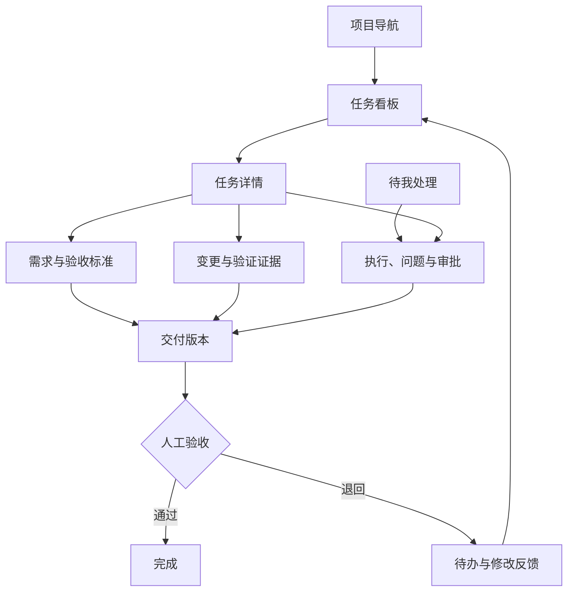
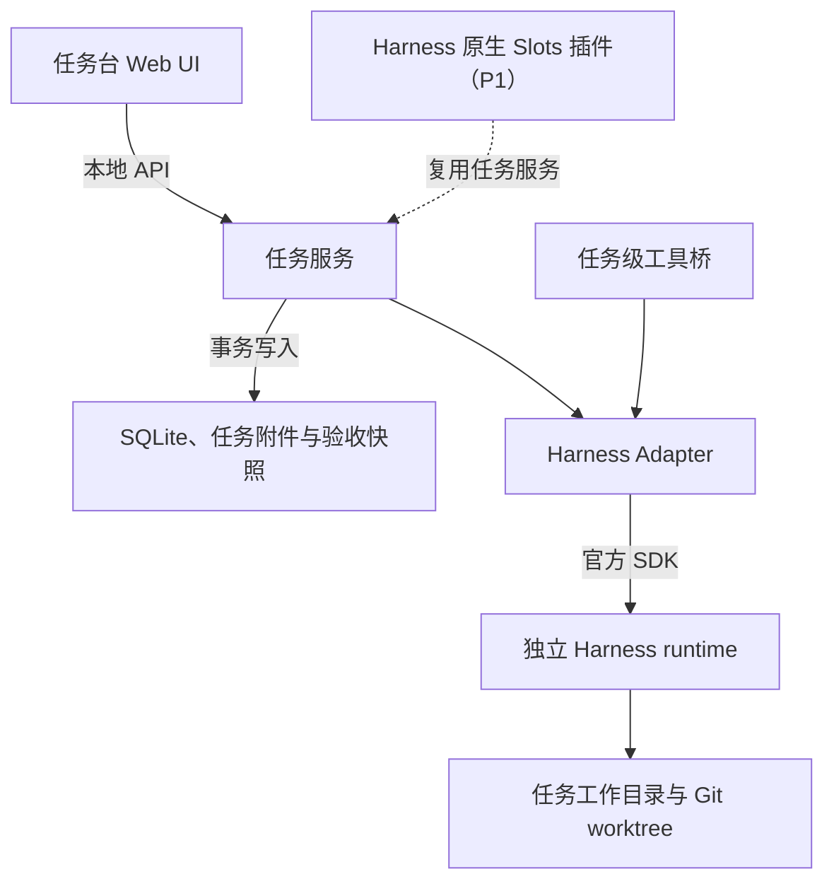

# DeepSeek Harness 任务工作台

**产品需求文档**

**版本：** v0.1
**日期：** 2026年11月11日
**状态：** 待评审

**关联文档：**[Word 原稿](DeepSeek_Harness_Taskboard_PRD_v0.1.docx)、[主 PRD](DSH_PRD_vNext_4_2026-10-27.md#93-任务工作台-mvp)、[实施任务映射](../workflows/DSH_IMPLEMENTATION_PLAN.md#16-taskboard-增量实施计划)、[执行进度](../workflows/DSH_IMPLEMENTATION_PLAN.md#1210-taskboard-增量-checklist)。本文件的独立 Web 入口为拟定方案，和主产品架构的适配决策归 TBOARD-00；功能完成情况以主 Plan 的证据为准。

> 格式说明：本文件保留 Word v0.1 的正文与表格；两张示意图改为可编辑的 Mermaid 结构图。支持 Mermaid 的 Markdown 阅读器可直接渲染图表。

## 概述

建设一个本地优先的 AI 编码任务工作台：以任务保存需求与验收，以 DeepSeek Harness 承载真实会话，以执行记录追踪每次尝试。用户从任务卡片启动工作，在同一处查看进度、回答问题、审查交付并确认完成。

### 本版产品决定

- MVP 采用独立的本地 Web 任务台，通过官方 TypeScript SDK 驱动 Harness。任务数据与会话数据分别管理，后续可增加 Harness 原生插件入口。

- 第一版服务单一操作者，面向个人开发者的日常编码任务；任务资料支持小团队交接，在线多人协作列入后续版本。

- 默认同时执行一个任务。每次活动执行使用独立 runtime，确认隔离与停止正确后再开放有限并行。

- Agent 可以报告进度、阻塞和交付；只有用户可以确认任务完成。权限审批和交付验收分别记录。

### 文档目标

为产品、设计、研发和测试提供同一套范围、状态规则、接口边界及发布标准。文中的 P0 为 MVP 必须满足的要求，P1 为下一阶段能力，P2 为后续探索。所有性能数字均为拟定验收目标，尚未形成实测基线。

| 范围 | 本版定义 |
| --- | --- |
| 产品名称 | Harness Taskboard 为暂定名称 |
| 交付形态 | 桌面浏览器访问本地服务；本地任务数据库与 Harness runtime |
| 主流程 | 创建任务 → 执行 → 提交交付 → 人工验收 → 完成或退回 |
| 版本约束 | Harness 仍处于开发者预览期；以通过接入验证的确切版本作为发布基线 [S01](https://github.com/deepseek-ai/deepseek-harness) |
| 首发平台 | 在 G0 根据实际开发环境冻结一个操作系统；其他平台通过兼容性验证后再标为支持 |

阅读顺序建议：先看第 1 至 4 节确定产品范围，再看第 5 至 10 节讨论行为与接入，最后以第 13 至 16 节评估发布条件。

## 目录

- [1 参考产品与设计结论](#1-参考产品与设计结论)
- [2 用户场景与版本范围](#2-用户场景与版本范围)
- [3 主流程与交互结构](#3-主流程与交互结构)
- [4 任务管理需求](#4-任务管理需求)
- [5 执行与恢复需求](#5-执行与恢复需求)
- [6 交付与人工验收需求](#6-交付与人工验收需求)
- [7 任务状态与转移规则](#7-任务状态与转移规则)
- [8 执行状态与事件一致性](#8-执行状态与事件一致性)
- [9 Harness 接入架构](#9-harness-接入架构)
- [10 接入能力与验证门槛](#10-接入能力与验证门槛)
- [11 数据模型与服务边界](#11-数据模型与服务边界)
- [12 可靠性与非功能需求](#12-可靠性与非功能需求)
- [13 功能验收用例](#13-功能验收用例)
- [14 恢复与控制验收用例](#14-恢复与控制验收用例)
- [15 迭代计划与风险](#15-迭代计划与风险)
- [16 待确认决策与评审清单](#16-待确认决策与评审清单)
- [17 参考来源](#17-参考来源)

## 1 参考产品与设计结论

既有参考覆盖任务管理、执行工作区、代码审查和多 Agent 协作。本产品选择任务与人工验收作为主线，按 MVP 所需逐项吸收。

| 参考 | 已核实的参考价值 | 本产品采用方式 |
| --- | --- | --- |
| dashi taskboard | 任务与会话绑定；Agent 回写进度；用户确认后完成 [S08](https://github.com/chuspeeism/dashi-taskboard/blob/main/README.zh-CN.md) | 采用任务字段、状态和待验收流程；重新设计 Harness Session 适配 |
| KanDev | 计划、对话、代码变更及审查集中在任务工作区 [S09](https://kandev.ai/) | 采用看板进入执行详情的结构；首版实现只读变更审查 |
| Vibe Kanban | Issue 与 Workspace 分离；看板旁展开详情与执行信息 [S10](https://www.vibekanban.com/docs/getting-started) | 参考任务卡片、详情侧栏和多次执行关联方式 |
| Multica | 任务保存讨论及执行历史；按阶段分派人或 Agent [S11](https://multica.ai/docs/issues) | 采用活动时间线、任务与运行分离；跨角色自动交接放入 P1 |
| Emdash Classic | 任务集中管理会话、终端、分支和审查状态 [S12](https://emdash.com/classic) | 采用执行详情信息组织；不在首版建设完整 IDE |

### 两个影响实现的判断

第一，界面嵌入与执行适配是两项工作。dashi 的已核实 DSH 集成快照使用侧栏入口与 iframe 打开独立 Taskboard；这证明了嵌入路径，但不能据此认定 Codex 的会话绑定逻辑可以直接用于 Harness。[S13](https://github.com/chuspeeism/dashi-taskboard/tree/5c96d1ab698362994283ba0af86021db0a98dd89/integrations/deepseek-harness)

第二，参考界面并不要求采用其完整产品架构。Vibe Kanban 已宣布转社区维护及移除原远程看板服务；Emdash Classic 的新功能开发重心已转移。它们在本 PRD 中作为界面与工作流参考，不作为运行依赖。[S10a](https://www.vibekanban.com/blog/shutdown)[S12](https://emdash.com/classic)

### 可追加评估的社区实现

cloader/dsh-taskboard 已公开 Harness 任务插件，可进一步参考任务级工具、独立会话与验收规则。该项目属于社区实现，兼容范围需按其确切版本核验；本 PRD 不把它的工具名称或方法视为官方 SDK 接口。[S14](https://github.com/cloader/dsh-taskboard)

## 2 用户场景与版本范围

### 目标用户与核心问题

主要用户同时推进多个编码事项，希望从任务找到需求、进度和产出。当前对话入口容易让需求版本、会话、分支与验收意见分散；遇到失败或中断时，也难以判断哪些结果仍然有效。

| 场景 | 用户需要完成的事 | 产品成功条件 |
| --- | --- | --- |
| 开始工作 | 把需求交给 Harness，保留验收标准 | 启动前能确认工程、输入版本与运行配置 |
| 跟进执行 | 知道在运行、等待回答还是出现问题 | 每张卡片有真实状态、最近事件和明确下一步 |
| 恢复工作 | 重试失败任务或继续原会话 | 原记录可追溯，新执行不覆盖旧结果 |
| 验收交付 | 检查变更与验证记录，接受或退回 | 验收指向特定交付版本，由用户确认 |
| 交接工作 | 把任务背景、执行历史与结论交给同事 | 导出的任务资料保留关联；在线协作另行建设 |

### P0 范围

项目与本地目录配置；任务看板与列表；需求及验收标准；手动开始、停止、重试与会话恢复；真实事件流；问题和审批处理；任务级工作目录锁；只读变更审查；交付与人工验收；事件持久化、重启对账、导出及备份恢复。

### P1 与 P2 范围

P1：Harness 原生插件入口、有限并行、父子任务与阻塞依赖、受控自动领取、团队账号及协作、PR 与 CI 集成。P2：跨机器执行、复杂 Agent 编排、定时自动化、成本预算、完整编辑器与浏览器预览。

### 优先级规则

影响执行身份、状态准确性、权限语义或人工验收的缺陷必须阻断发布。外观精修、图表和复杂筛选不抵消上述缺陷。首发支持的操作系统、备份目录及模型配置在 G0 冻结，界面只展示实际通过验证的组合。

## 3 主流程与交互结构

信息架构采用项目导航、任务看板、任务详情三部分。任务卡片以标题、优先级、执行状态和待处理事项为主；日志、会话标识和环境细节放在执行页。

*图 1 任务看板与验收详情布局示意  示例任务仅用于说明产品交互*

| 页面 | 主要内容与操作 |
| --- | --- |
| 任务总览 | 切换项目、状态列、列表视图；搜索标题；按优先级和待处理事项筛选 |
| 任务详情 | 需求、验收标准、评论、历史执行；开始或重试；查看需求版本差异 |
| 执行详情 | 实时活动、问题、审批、会话信息、工作目录、只读文件变更、停止操作 |
| 交付验收 | 实现说明、变更摘要、验证记录、风险与未完成项；接受或退回 |
| 运行与设置 | 接入健康状态、兼容版本、模型配置、备份及导出 |

主流程：建立工程 → 创建需求及验收标准 → 检查配置 → 开始执行 → 处理问题或审批 → 形成交付 → 人工接受或退回。运行期间关闭详情页不会停止任务。

## 4 任务管理需求

### FR01 项目与接入检查

项目绑定规范化的本地目录，可记录 Git 仓库与默认基线分支。首次使用检查 Harness 可执行版本、SDK 连接、凭据可用性、目录权限及运行配置。配置页显示可用、不可用与待验证能力。

**验收要点：**错误信息能指出具体缺项；不满足启动条件时保留任务编辑能力，并禁止开始执行。

### FR02 任务字段与看板

任务包含标题、描述、验收标准、优先级、标签、项目、状态和版本号。创建时标题与项目必填；开始执行前须有明确目标和至少一条验收标准。支持看板拖拽、排序、搜索及状态筛选。

**验收要点：**允许的拖拽调用统一状态规则；将任务拖到完成列必须进入验收流程，不能直接改状态。

### FR03 需求版本与上下文

每次修改描述或验收标准产生任务版本。开始时保存输入快照，包含需求、验收、所选文件引用、前次反馈和运行配置。活动 Run 的快照保持不变；对应旧需求版本的交付标记为已过期。

**验收要点：**运行中提示“需求已更新，本次执行仍使用版本 N”；下一 Run 显式采用新版本。

### FR04 评论与历史

评论区统一展示用户讨论、Agent 进度摘要、状态变化、执行记录、交付和验收决定。作者、时间及来源可追溯，长日志按需展开。

**验收要点：**重试或归档不覆盖旧日志；历史事件只追加更正记录，不静默改写。

### 输入与界面边界

任务附件按用户选择纳入上下文，不自动读取整个文件系统。原始任务与附件内容作为待处理资料，不作为提升权限或代替人工验收的指令。默认不显示模型不可用的能力，也不使用伪造百分比表示执行进度。

## 5 执行与恢复需求

### FR05 手动启动与排队

用户开始执行时，服务原子校验任务版本、活动执行锁及工作目录锁，生成幂等键和 Run。先持久化启动意图，再创建 runtime。默认并发为 1，同一任务和同一 Session 均只能有一个活动执行所有者。

**验收要点：**双击开始、请求重放及重启恢复都不能产生额外有效执行；排队任务可直接取消。

### FR06 进度与待处理事项

以 Harness 的真实事件和状态驱动界面。问题与权限请求分别进入“待我处理”；卡片显示数量、最近事件和连接情况。流式日志可以折叠，但原始可追溯记录须保留。

**验收要点：**事件重复不重复显示；断流只显示连接异常，不能仅凭静默推断任务成功、失败或停止。

### FR07 停止与取消

活动执行先进入“正在停止”。Adapter 对该 Run 独占 runtime 发起 shutdown，并确认目标进程树退出。超过时限时显示未确认状态，可由用户选择强制结束。队列取消和运行中断分别记录。

**验收要点：**SDK 当前无单会话取消接口；不能用不存在的接口承诺精确取消。仅停止目标 Run，不清理其代码成果。[S03](https://github.com/deepseek-ai/deepseek-harness/blob/master/packages/sdk/server/README.md)

### FR08 重试与会话恢复

重试、退回修改或继续执行均新建 Run，记录前序 Run。用户点击继续执行后，先恢复真实 Session，再显式发送本次已确认的输入快照。仅查看历史不发送输入；恢复失败由用户选择新会话和继承内容。

**验收要点：**保存输入接纳回执，发送结果未知时先对账，不能盲目重发。恢复不自动重建外部进程，继续前校验目录与分支。[S02](https://github.com/deepseek-ai/deepseek-harness/blob/master/packages/sdk/client/README.md)

### FR09 工作目录管理

Git 项目固定基线 commit 后创建 worktree，并验证 Session 的实际工作目录。要求隔离时，创建失败即阻止启动。用户可显式改为原目录串行，并重新确认分支和未提交变更后新建 Run。非 Git 目录仅允许串行。

**验收要点：**基线缺失、目录占用和路径别名均受检查；隔离失败不发送输入；结束或验收不删除目录。

## 6 交付与人工验收需求

### FR10 结构化交付

Agent 提交交付说明、变更范围、逐条验收结果、验证证据、已知问题与未完成项。服务记录 Delivery 版本、对应 Run、需求版本及代码快照。验证状态仅允许通过、失败、未执行或不适用。

**验收要点：**模型文本中的“完成”及运行返回 0 都不能直接生成 Done；缺少必填证据时提示补齐。

### FR11 审查变更

首版提供文件清单与只读文本 Diff，展示基线、当前变更及二进制文件提示。超大 Diff 可分段加载或通过外部工具查看。非 Git 目录明确显示可核实的文件记录范围。

**验收要点：**验收前检测 HEAD、未提交变更及纳入交付的未跟踪文件是否变化；不能只比较 commit ID。

### FR12 接受与退回

用户在指定 Delivery 上逐条审查验收标准。接受后记录 Review；退回时保存意见，任务回待办，下一 Run 带入反馈。需求版本已过期的交付须重新覆盖新标准，或由用户显式撤销需求变更并留痕。

**验收要点：**校验当前需求版本与代码快照；活动执行或未决审批阻止验收；验证失败项须由人记录豁免理由。

### FR13 权限审批与用户问题

工具授权只作用于当前请求，保留 Harness 原有范围与结果语义。普通问题仅补充任务信息。两者分别显示、分别路由，回复必须匹配真实请求及所属 Run。

**验收要点：**审批断线、撤销或过期后不能由迟到回复放行；拒绝和取消不得自动改为允许。[S04](https://github.com/deepseek-ai/deepseek-harness/blob/master/packages/sdk/protocol/README.md)[S05](https://deepseek-harness.github.io/deepseek-harness/en/reference/subsystems/approval)

### FR14 归档与完成后修改

已完成任务保留交付、验收、Session 引用及执行记录。新增需求通过显式重新打开任务或新建关联任务处理；历史验收保持原样。

**验收要点：**Agent 不具有完成、人工豁免、接受交付或改写历史验收的权限。

## 7 任务状态与转移规则

Task 表达工作目标的业务进展；Run 表达一次实际执行。等待问题、等待审批和连接异常以独立标记显示，避免把短暂等待直接写成业务阻塞。

| 状态 | 含义 | 进入与离开规则 |
| --- | --- | --- |
| backlog 待规划 | 尚未安排执行 | 用户整理到 todo；不直接调度 |
| todo 待办 | 可选择启动的工作 | 输入与环境检查通过后开始；启动成功再转 in_progress |
| in_progress 进行中 | 任务有执行或待处理的执行结果 | 执行结束并形成有效 Delivery 后转 in_review；明确失败可转 blocked |
| in_review 待验收 | 存在指定版本的可审查交付 | 用户接受转 done；退回转 todo；无人工确认不得完成 |
| blocked 已阻塞 | 缺少条件或发生需处理的失败 | 必须记录原因；条件解除后用户重新放回 todo |
| done 已完成 | 用户接受了某个 Delivery | 保留 Review；后续继续需显式重开或建立新任务 |
| canceled 已取消 | 用户决定不再推进目标 | 若有活动执行，先确认执行终止；恢复需显式转 todo |

### 自动转移的条件

执行启动成功可将待办任务置为进行中。进入待验收必须同时满足：存在有效 Delivery、所属 Run 已结束、无未决问题或审批、交付快照可定位。失败或验证未执行可以提交给用户审查，但必须明确展示，不能冒充通过。

### 服务端强约束

Agent 写入只允许报告进度、阻塞、评论及交付；Task 的 done 只能由人工验收命令产生。状态命令必须携带期望版本，并在同一事务中校验版本、执行锁和转移条件。发生冲突时显示新状态，由用户重新操作。

任务取消、运行停止、交付退回是三个不同动作。停止一次 Run 后默认将任务标为 blocked，原因是“执行已中断”；取消任务则代表用户放弃本项工作。

## 8 执行状态与事件一致性

| Run 状态 | 含义 | 判定证据 |
| --- | --- | --- |
| queued | 等待可用执行槽位 | 已持久化执行请求，尚未分配 runtime |
| preparing | 准备目录与运行环境 | runtime 启动或 Session 创建恢复中 |
| running | 已进入执行活动区间 | 真实 SDK 事件与状态；保存开始时间 |
| finished | 本次活动区间已结束 | SDK 结束且独占 runtime 已确认退出；不等于任务验收 |
| failed | 明确执行失败 | 启动错误、协议错误或已确认的运行失败 |
| canceled | 启动前取消 | 未执行任何工作且队列取消事务成功 |
| interrupted | 运行被打断 | 停止、runtime 退出、强制结束或核实后的失联 |

控制状态为 normal、finalizing 或 stop_requested；连接状态单独记录 connected、suspect 或 disconnected。待回答和待审批分别计数，出现审批不能被理解为所有子进程均已暂停。

### 从 Harness 事件到产品状态

session/prompt 返回的 messageId 只表示输入已被接纳；session.status 的 idle 和 SDK run 返回只反映活动区间。Adapter 必须结合 Run 归属、有效交付及待处理请求判定产品状态，不能用单条“最终文本”或 idle 直接验收。[S02](https://github.com/deepseek-ai/deepseek-harness/blob/master/packages/sdk/client/README.md)[S03](https://github.com/deepseek-ai/deepseek-harness/blob/master/packages/sdk/server/README.md)[S04](https://github.com/deepseek-ai/deepseek-harness/blob/master/packages/sdk/protocol/README.md)

### 重复事件与重启对账

优先使用官方持久事件身份；若通知不具备稳定可重放标识，Adapter 保存原始载荷与自有事件游标，并在重新连接时进行 Session 与运行快照核对。旧事件不得回退新终态，历史记录与新通知分开导入。

重启对账页显示 Run、runtime 身份、最后事件及目录占用，提供重新核对和终止已确认归属执行的操作。通道不能接管时明确提示；确认原实例退出后标中断并释放锁，再允许新 Run 恢复会话。不得仅凭 PID 或租约过期判断归属和释放锁。

### 执行收尾

SDK 活动结束后先保存结果回执，再关闭该 Run 的独占 runtime；退出确认后封存代码快照和交付，提交终态并释放租约。dshHome 和代码目录保留。无有效交付时，任务转 blocked 并显示“执行结束，待补交付”，允许依据真实记录补录或新建 Run。

## 9 Harness 接入架构

采用单一执行控制路径：任务服务经 Harness Adapter 调用官方 SDK，由独立 runtime 运行 Session。任务服务持有业务状态和验收权，Harness 持有执行与模型工具语义。[S01](https://github.com/deepseek-ai/deepseek-harness)[S02](https://github.com/deepseek-ai/deepseek-harness/blob/master/packages/sdk/client/README.md)

*图 2 建议架构  属于本产品设计  原生插件入口为 P1 并复用同一任务服务*

### 数据和执行所有权

Task 数据库为业务状态唯一事实源。每个 Run 记录 runtime 身份、Session 引用、任务快照与目录租约。runtime 独占当前执行，持久 dshHome 归任务或明确的会话域管理；旧实例退出并释放租约后，下一 Run 才可恢复同一会话。

### 插件与 MCP 的职责

Harness 原生 Slots 和右侧栏可承载后续入口，避免依赖 DOM 注入。[S06](https://deepseek-harness.github.io/deepseek-harness/en/reference/subsystems/slots) MCP 可将任务服务工具暴露给 Agent；会话启动、恢复和停止仍归 Adapter。不得让原生 Web runtime 与 SDK runtime 同时接管同一 Session。[S07](https://github.com/deepseek-ai/deepseek-harness/blob/master/packages/mcp/README.md)

## 10 接入能力与验证门槛

| 能力 | 官方已核实事实 | 本产品实现与验证 |
| --- | --- | --- |
| 开始执行 | 提供 TS SDK 和 stdio JSON RPC 会话驱动 [S02](https://github.com/deepseek-ai/deepseek-harness/blob/master/packages/sdk/client/README.md)[S04](https://github.com/deepseek-ai/deepseek-harness/blob/master/packages/sdk/protocol/README.md) | Adapter 初始化后创建真实 Session；记录确切版本及配置摘要 |
| 事件同步 | 提供 Session 事件与状态通知 [S04](https://github.com/deepseek-ai/deepseek-harness/blob/master/packages/sdk/protocol/README.md) | 归一化事件；验证重复、断线和历史回读，不承诺无条件自动重放 |
| 恢复会话 | 支持持久 Session 恢复；不会自动发新输入 [S02](https://github.com/deepseek-ai/deepseek-harness/blob/master/packages/sdk/client/README.md)[S03](https://github.com/deepseek-ai/deepseek-harness/blob/master/packages/sdk/server/README.md) | 核对 sessionId、dshHome、目录与占用状态；失败保留原记录 |
| 停止执行 | 当前无 per-session close 或 prompt-cancel wire 方法 [S03](https://github.com/deepseek-ai/deepseek-harness/blob/master/packages/sdk/server/README.md) | 按 Run 独立 runtime；shutdown 后确认退出；强制终止按中断记录 |
| 人工审批 | 可启用 approvalRequests 并接收 approval/request [S03](https://github.com/deepseek-ai/deepseek-harness/blob/master/packages/sdk/server/README.md)[S04](https://github.com/deepseek-ai/deepseek-harness/blob/master/packages/sdk/protocol/README.md) | 展示范围与动作；允许一次、拒绝、取消；验证断线后迟到回复 |
| 用户问题 | 协议提供 user-question/ask 与取消通知 [S04](https://github.com/deepseek-ai/deepseek-harness/blob/master/packages/sdk/protocol/README.md) | 独立问题入口；匹配请求身份；取消后禁止继续回答 |
| 界面扩展 | 提供 React Slots 与右侧栏注册机制 [S06](https://deepseek-harness.github.io/deepseek-harness/en/reference/subsystems/slots) | P1 原生入口；同一任务服务与控制路径 |
| 工具连接 | MCP 作为连接外部工具和资源的客户端能力 [S07](https://github.com/deepseek-ai/deepseek-harness/blob/master/packages/mcp/README.md) | P0 任务级工具桥；MCP 开放集成放 P1 |
| 目录隔离 | Session 可设置工作目录；沙箱模式针对文件效果 [S04](https://github.com/deepseek-ai/deepseek-harness/blob/master/packages/sdk/protocol/README.md)[S15](https://deepseek-harness.github.io/deepseek-harness/en/reference/subsystems/sandbox) | worktree 由产品管理；显示有效权限，不把目录分开等同完整安全隔离 |

### G0 必须完成的接入验证

创建真实会话；连续两次执行关联同一任务；关闭 runtime 后恢复原会话；工具请求的允许、拒绝与取消；用户问题响应；停止一个 runtime 不影响另一实例；工作目录变化可追溯；服务中断后不重复执行。

以上验证通过后冻结 Harness、SDK、runtime 组合及操作系统版本。任何关键能力未通过都先调整范围或适配实现，不以模拟状态满足验收。Harness 升级必须重跑同一组兼容用例。[S01](https://github.com/deepseek-ai/deepseek-harness)

## 11 数据模型与服务边界

| 对象 | 职责与主要字段 |
| --- | --- |
| Project | projectId、规范化根目录、仓库和基线分支、运行配置引用 |
| Task | taskId、projectId、需求、验收标准、优先级、状态、version、当前交付引用 |
| Run | runId、taskId、前序 Run、输入快照、sessionRef、runtimeId、目录租约、状态、结束原因 |
| SessionRef | provider、真实 sessionId、dshHome 引用、workspace、兼容版本、恢复状态 |
| Delivery | deliveryId、taskId、runId、任务版本、交付版本、变更快照、验证证据、未完成项 |
| Review | reviewId、deliveryId、快照指纹、接受或退回、验收人、理由及时间 |
| Event | eventId、runId、原始来源身份、产品游标、类型、脱敏载荷、发生与接收时间 |
| Interaction | 请求类型、原请求 ID、runId、待处理或终态、响应结果、有效期和撤销记录 |
| Lease | 执行与目录所有权、runtime 身份、租约代次、活动状态及对账结果 |

### 关联与约束

一个 Task 有多个 Run 和多个 Delivery；每个 Run 指向一个主 Session，子 Agent 事件作为从属执行记录。多个 Run 可顺序复用同一主 Session，但不得并发占用。每个 Review 固定指向一个 Delivery 版本及其代码快照。

### 产品服务命令

界面命令包括创建修改任务、开始、停止、重试、恢复、回答问题、处理审批、提交验收、接受和退回。Agent 工具建议限定为读取当前任务、报告进度、添加评论、提交交付、报告阻塞。以上是本产品逻辑能力名称，不是官方 Harness API。

所有写入校验 actor、任务作用域、runId、期望版本和幂等键。模型提供的标识仅作为输入，不能决定其权限；runId、会话归属和可写范围由服务端绑定。结果回写使用事务，记录状态变更及其来源。

## 12 可靠性与非功能需求

| 编号 | 要求 | 验收目标或规则 |
| --- | --- | --- |
| NFR01 | 状态可解释 | 每个异常可见原因、最近事件与下一步；不把未知标成成功 |
| NFR02 | 交互性能 | 参考环境 8 核 16 GB SSD、本地连接、2000 任务：看板首屏 P95 不超过 2 秒；状态到达服务后 1 秒内反映到界面 |
| NFR03 | 持久化 | 关键命令先落库再回执；状态与活动记录原子提交；崩溃后不丢已确认验收 |
| NFR04 | 恢复一致 | 重启不重复执行；事件重复不重复入账；已有终态不被旧事件覆盖 |
| NFR05 | 权限语义 | 默认本机回环服务；操作校验来源与会话令牌；原生权限配置应用失败时禁止启动 |
| NFR06 | 凭据与日志 | 凭据由受控配置管理；不写入任务、普通日志或默认导出包；工具输出进行脱敏和按需展开 |
| NFR07 | 数据可迁移 | 提供版本化导出及备份恢复；保留任务、运行、交付和验收关联；导入后不启动运行 |
| NFR08 | 资源与文件 | 停止或结束不自动删除工作目录；清理显示归属和未提交修改，用户显式选择 |
| NFR09 | 兼容性 | 发布包记录已验证版本矩阵；不兼容升级可停止接入并保留数据；迁移前创建备份 |

### 异常处理的最低要求

凭据过期和服务不可用：保留任务并显示修复入口。审批未响应：保留待处理状态，不能自动放行。输出上限或运行错误：保存已产生文件与日志，显示结束原因并允许新建 Run。磁盘不足或持久化失败：禁止继续接受新的执行与验收命令，避免界面显示未保存的成功。

### 导出 备份与保留

交接导出默认包含任务、Run 摘要、交付、验收及选定附件，不含凭据、原始工具输出或完整会话目录。恢复备份须带版本、内容清单与校验信息，明确 Session 数据是否齐全；会话恢复能力取决于这些数据及版本兼容性。

无活动执行时恢复到新数据库或实例。损坏、不兼容或 ID 冲突均不得静默覆盖合并。恢复不重建进程、不重放审批、不启动执行。默认不自动删除任务或验收证据；清理日志、附件、Session 与工作目录分别选择，并保护仍被交付和验收引用的证据。

## 13 功能验收用例

以下为发布必测场景。测试使用隔离工程，保存事件与进程归属证据；不能仅依据界面提示判定通过。

| 编号 | 场景 | 通过标准 |
| --- | --- | --- |
| AC01 | 保存后重启 | 需求、验收、状态、排序和任务 ID 一致；已确认写入完整恢复 |
| AC02 | 双击启动与请求重放 | 只有一个有效 Run 和执行实例；重复请求返回同一结果 |
| AC03 | 执行中修改需求 | 任务版本递增；旧 Run 快照保持不变；显示版本变化 |
| AC04 | 失败后重试 | 创建新 Run，关联前序执行；旧错误、日志和会话引用可查看 |
| AC05 | Agent 自称完成 | 无人工 Review 时任务不进入 done；运行结束与验收分离 |
| AC06 | 验证失败或未执行 | 如实显示验证状态与证据；不伪造通过；豁免由人记录理由 |
| AC07 | 退回修改 | 反馈指向原 Delivery；下一 Run 带入反馈，旧交付不覆盖 |
| AC08 | 验收过程中结果变化 | 需求或验收标准更新使旧交付过期；活动执行或代码变化阻止验收；仅刷新旧 Diff 不能解除 |
| AC09 | 用户问题 | 内容及所属任务准确；回答只投递原请求；取消后不能发送 |
| AC10 | 原生权限审批 | 允许一次、拒绝、取消均保持原语义；断线或过期不默认允许 |

### 验收证据

每次运行记录软件版本、运行配置摘要、任务和 Run 标识、工作目录、关键事件、退出状态及最终数据库记录。权限用例同时核对 Harness 返回结果与外部操作是否发生；验收用例同时核对 Delivery 快照和 Review 记录。

## 14 恢复与控制验收用例

| 编号 | 场景 | 通过标准 |
| --- | --- | --- |
| AC11 | 会话丢失或不兼容 | 明确恢复失败，不偷偷创建替代会话；用户可选择新 Run 和上下文 |
| AC12 | 停止目标执行 | 先显示正在停止；确认目标进程树退出后标中断；不影响其他实例 |
| AC13 | 任务服务突然重启 | 核对租约与进程身份，不重新发送原启动请求；未知状态可见 |
| AC14 | 事件乱序与短时断流 | 不重复入账、不回退终态；断线恢复后核对真实 Session 与结果 |
| AC15 | 目录冲突与隔离失败 | 别名和父子目录受锁保护；基线缺失、目录占用或 worktree 创建失败不静默降级 |
| AC16 | 导入备份 | 损坏、版本不兼容和 ID 冲突不覆盖现有数据；标明缺失 Session；不恢复进程或审批 |
| AC17 | runtime 启动后写库失败 | 进入可追踪的启动对账；不遗留可重复启动的未知执行 |
| AC18 | 强制结束超时 | 显示仍无法确认的状态，保留锁与目录；不假报已停止 |
| AC19 | 权限配置应用失败 | 阻止启动并展示原因；不会静默使用更宽权限继续执行 |
| AC20 | 升级不兼容 | 拒绝不受支持的会话接入；数据与快照保留，恢复路径可执行 |

### 发布质量门槛

所有 P0 用例通过。重复启动产生的非预期执行为 0；done 任务的人工 Review 完整率为 100%；已确认验收丢失为 0；审批范围扩大和停止其他任务的误操作为 0。发布前完成至少一轮真实编码任务的开始、失败重试、交付、退回、再验收全过程。

上述数值是受控验收中的质量门槛，不代表生产环境已达到的可靠性指标。首次任务耗时、任务查找耗时和验收耗时在试用阶段建立基线，再决定优化目标。

## 15 迭代计划与风险

| 阶段 | 交付内容 | 退出标准 |
| --- | --- | --- |
| G0 接入验证 | 冻结 Harness SDK runtime 与操作系统组合；验证 Session、审批、问题、停止与恢复 | 第 10 节接入用例全部通过；形成能力矩阵和缺口处置 |
| G1 任务闭环 | 项目与看板、任务版本、手动执行、事件记录、交付及人工验收 | AC01 至 AC10 通过，可完整交付一个任务 |
| G2 恢复加固 | 目录锁、启动幂等、进程对账、备份及兼容性控制 | AC11 至 AC20 通过，满足全部发布门槛 |
| G3 能力扩展 | 原生插件入口、有限并行、依赖关系和受控自动领取 | 保持 P0 质量门槛；新增并发和权限回归通过 |
| G4 团队协作 | 账号、角色、协作编辑、远程节点、PR 与 CI | 单独完成权限模型及跨设备恢复验收 |

### 主要风险与应对

- Harness 预览版接口变化：锁定确切组合，升级先做兼容性验证；产品层不直接依赖内部 UI 结构。[S01](https://github.com/deepseek-ai/deepseek-harness)

- SDK 停止粒度与资源开销：MVP 使用独立 runtime 与默认串行；实测内存和停止延迟后决定并发上限。[S03](https://github.com/deepseek-ai/deepseek-harness/blob/master/packages/sdk/server/README.md)

- 会话和代码脱节：恢复时检查目录、分支、权限与变更快照；不把对话恢复等同外部环境恢复。[S02](https://github.com/deepseek-ai/deepseek-harness/blob/master/packages/sdk/client/README.md)

- 模型报告与实际交付不一致：结果必须附变更与验证证据，人工验收指向固定交付版本。

- 社区参考与官方版本不匹配：社区项目仅作为设计或实现参考；代码复用前独立核验版本与许可证。[S14](https://github.com/cloader/dsh-taskboard)

排期采用阶段退出标准；工期和人员投入在 G0 技术验证后估算，不在本版承诺具体上线日期。

## 16 待确认决策与评审清单

| 决策 | 本版默认方案 | 影响与确认时点 |
| --- | --- | --- |
| 产品入口 | 独立本地 Web 任务台；Harness 原生嵌入列 P1 | 若原生嵌入是首要目标，在 G0 调整外壳与执行所有权设计 |
| 目标用户 | 个人开发者优先，单操作者；兼顾资料交接 | 若需多人在线首发，需增加身份与并发编辑范围 |
| 首发平台 | 按实际工作环境选择一个平台完成完整验收 | G0 冻结操作系统、Shell 与沙箱能力矩阵 |
| 并发范围 | 默认一个活动任务，其他排队 | 只有独立目录与停止隔离验证通过才开放更多 |
| 执行触发 | 用户手动启动、手动重试 | 自动领取需单独定义授权、任务条件与最大执行次数 |
| 代码交付 | 只读 Diff 与人工确认；不默认自动合并 | PR、CI 和自动合并按需求进入后续版本 |
| 部署与同步 | 本地服务与本地数据，不默认对外暴露 | 跨设备同步、远程执行与团队服务另立范围 |
| 底层实现 | 官方 SDK Adapter；任务工具由产品控制 | 是否复用社区代码，在兼容性与许可证评估后确定 |

### 评审时需要形成的结论

- 产品评审确认入口、首发用户、P0 范围与验收操作。

- 技术评审确认经过验证的 Harness 版本、runtime 归属、停止与恢复策略。

- 设计评审确认看板信息、待处理事项、交付快照和异常文案。

- 测试评审确认 20 个验收用例的场景、证据和失败判据。

本版以这些默认方案形成可继续细化的需求基线。进入开发前应冻结 G0 结论；后续范围变更记录版本、原因及受影响的需求和用例编号。

## 17 参考来源

资料核查日期为 2026年11月11日。来源中的产品能力与本 PRD 的建议需求分开表述；官方 SDK 与插件均需针对发布版本再次验证。点击以下标题可打开原始资料。

- **[S01 · DeepSeek Harness 官方仓库](https://github.com/deepseek-ai/deepseek-harness)**
  官方身份、插件架构、developer preview 与兼容性变化提示。

- **[S02 · DeepSeek Harness TypeScript SDK](https://github.com/deepseek-ai/deepseek-harness/blob/master/packages/sdk/client/README.md)**
  run、会话恢复、活动区间与客户端使用语义。

- **[S03 · DeepSeek Harness SDK Server](https://github.com/deepseek-ai/deepseek-harness/blob/master/packages/sdk/server/README.md)**
  审批桥、Session 恢复、shutdown 与单会话取消限制。

- **[S04 · DeepSeek Harness SDK Protocol](https://github.com/deepseek-ai/deepseek-harness/blob/master/packages/sdk/protocol/README.md)**
  JSON RPC 方法、事件、审批和用户问题协议。

- **[S05 · DeepSeek Harness User Approval](https://deepseek-harness.github.io/deepseek-harness/en/reference/subsystems/approval)**
  审批身份、一次性允许、拒绝、取消与不可用结果。

- **[S06 · DeepSeek Harness Web Client Slots](https://deepseek-harness.github.io/deepseek-harness/en/reference/subsystems/slots)**
  原生 Web UI 扩展机制；相关 Right Sidebar 文档提供停靠页能力。

- **[S07 · DeepSeek Harness MCP](https://github.com/deepseek-ai/deepseek-harness/blob/master/packages/mcp/README.md)**
  连接外部 MCP 工具和资源的边界。

- **[S08 · dashi taskboard 中文说明](https://github.com/chuspeeism/dashi-taskboard/blob/main/README.zh-CN.md)**
  本地看板、CLI 和 Skill、待验收与人工完成流程。

- **[S09 · KanDev 官方产品页](https://kandev.ai/)**
  任务、计划、执行、工作区与代码审查布局。

- **[S10 · Vibe Kanban 上手教程与维护变更](https://www.vibekanban.com/docs/getting-started)**
  任务与 Workspace；维护变更见下一条官方公告。

- **[S10a · Vibe Kanban 官方关闭公告](https://www.vibekanban.com/blog/shutdown)**
  公司关闭、社区维护及原远程服务退出范围。

- **[S11 · Multica Issues 文档](https://multica.ai/docs/issues)**
  任务字段、执行历史、讨论和交付记录。

- **[S12 · Emdash Classic 官方产品页](https://emdash.com/classic)**
  任务工作台与 Classic 的维护定位。

- **[S13 · dashi 的 DSH 集成固定提交](https://github.com/chuspeeism/dashi-taskboard/tree/5c96d1ab698362994283ba0af86021db0a98dd89/integrations/deepseek-harness)**
  侧栏与 iframe 集成参考；固定提交，不代表全部后续能力。

- **[S14 · cloader 的社区 Harness 任务插件](https://github.com/cloader/dsh-taskboard)**
  社区实现参考；兼容版本与授权须独立核实。

- **[S15 · DeepSeek Harness Process Sandbox](https://deepseek-harness.github.io/deepseek-harness/en/reference/subsystems/sandbox)**
  文件效果策略与平台实际执行范围。
